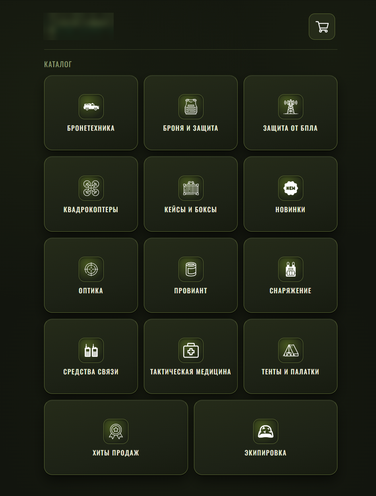
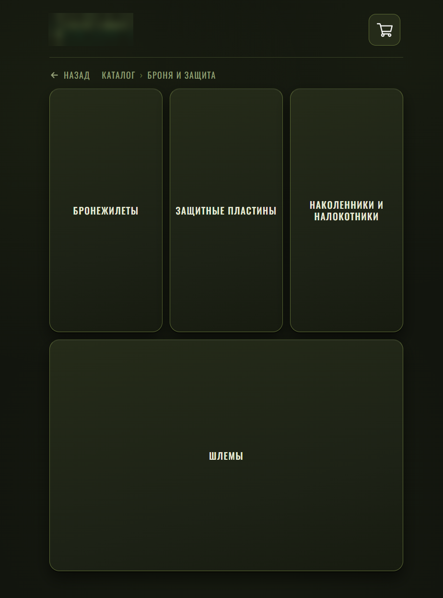
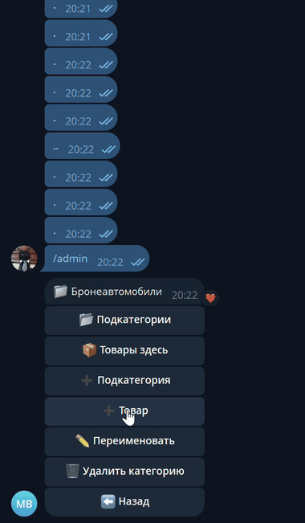
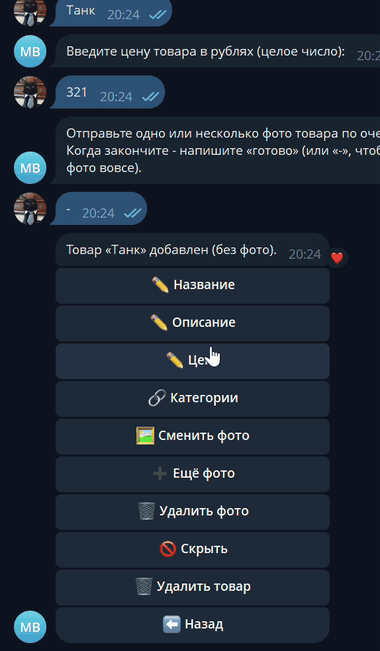
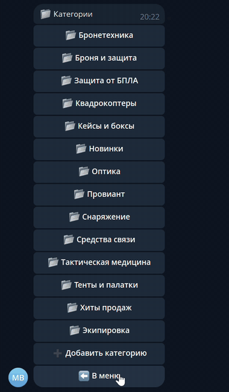
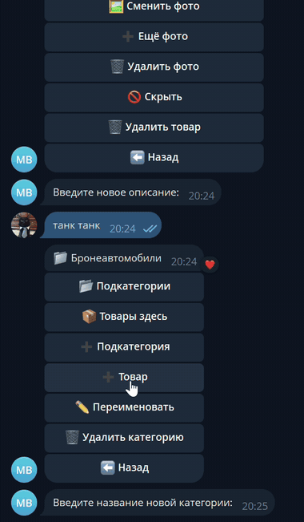

# Telegram-магазин: бот + Mini App

Магазин внутри телеграма. Клиент открывает каталог прямо в чате, собирает корзину и оформляет заказ, а продавец принимает заказы и ведёт весь каталог из того же бота, отдельной админки на сайте нет, это было одно из основных требований заказчика.

Проект в эксплуатации, работает на VPS с HTTPS. Код принадлежит заказчику, поэтому здесь только описание, скриншоты и записи работы..

<p>
  
  
</p>

## Что умеет

Со стороны клиента всё открывается кнопкой в боте. Каталог с вложенными категориями, карточка товара с галереей, корзина (лежит в браузере), оформление: самовывоз, курьер или CDEK, юзернейм по желанию и комментарий. Если в корзине что-то осталось, а заказ не оформлен, бот через пару часов напомнит об этом в чат.

Со стороны продавца команда `/admin`, она открывается только для своих telegram id. Категории и подкатегории, товары (пошагово, несколько фото, доп. категории, скрыть или удалить), заказы (список, состав, статусы, удаление). О каждом новом заказе приходит уведомление с кнопками. Ещё любое сообщение клиента боту пересылается продавцу, а ответ через Reply уходит клиенту от имени бота.


## Стек

Python 3.14, aiogram 3, FastAPI + uvicorn, SQLAlchemy 2 (async) и SQLite в режиме WAL. Mini App на голом HTML, CSS и JS без сборки. Наружу всё смотрит через Caddy (сертификаты Let's Encrypt), запускается как systemd-сервис на Ubuntu.

## Как устроено

```
телеграм-клиент
   |  Mini App (https)              |  сообщения бота
   v                                v
 Caddy ---> uvicorn (FastAPI) <--- aiogram (long polling)
                  |
              SQLite (WAL)
```

Бот и веб-сервер живут в одном процессе. Данные пользователя в Mini App приходят подписанными телеграмом (initData), сервер проверяет подпись по токену бота и больше ничему от клиента не верит.

## Сложности при разработке

**Цена из браузера.** Корзина лежит у клиента, цену в запросе можно поменять через консоль. Поэтому сервер цену и название из запроса вообще не берёт, всё тянет из базы по id товара. Количество тоже зажато в диапазон.

**initData живёт вечно.** Подпись сама по себе не протухает, то есть утёкшую строку можно было бы слать когда угодно. Добавил проверку возраста, сутки. Заодно кривая строка вместо initData раньше валила сервер в 500, теперь 401.

**database is locked.** Когда сделал нагрузочный тест, SQLite на параллельных записях начала падать. Включил WAL и busy_timeout, а "найти или создать" клиента переписал одним запросом (INSERT ... ON CONFLICT), потому что два заказа подряд от нового клиента спотыкались об уникальный telegram id.

**Бот не останавливался.** Цикл напоминаний сидел в одном gather с ботом и сервером и не давал процессу выйти, systemd ждал полторы минуты и добивал его. Переделал завершение, когда падает или выходит бот или сервер, остальные задачи отменяются.

**Уведомления терялись.** Ошибки отправки админу просто пропадали, заказ мог не дойти, а в логах пусто. Теперь пишу в лог, при лимитах телеграма жду и повторяю, а если заказ не дошёл ни до одного админа, в логе ERROR. Отправку вынес в фон, чтобы клиент не висел на оформлении, пока телеграм тормозит.

**Лимит на длину сообщения.** Заказ с огромным комментарием создавался, а уведомление не уходило (в телеграме потолок 4096 символов). Ограничил комментарий и количество позиций.

**Python 3.14 на сервере.** Закреплённые версии библиотек не имели под него готовых сборок, и pip пытался собирать Rust и C из исходников. Подобрал версии с готовыми wheels, проверил под нужную платформу и заново прогнал тесты.

**Адрес для Mini App.** Пока разрабатывал, магазин ходил через временный туннель cloudflare, адрес менялся при каждом падении, а телеграм ещё и кэшировал старую кнопку меню. Теперь бот сам прописывает кнопку при каждом старте из настроек, а на сервере постоянный адрес с HTTPS.

**Баг, который виден только с данными.** Список заказов в админке падал, как только появлялся первый заказ (обращение к полю, которого нет), а на пустой базе всё выглядело нормально. После этого написал тест, который строит все клавиатуры и тексты админки на заполненной базе.

## Безопасность

- подпись telegram (initData) проверяется по HMAC, сравнение через `compare_digest`, подпись действует не дольше суток;
- цена и название товара в заказе только из базы, всё что прислал браузер игнорируется;
- запросы к базе только через ORM с параметрами, гонял типовые инъекции (`DROP TABLE`, `OR 1=1` и тд) в комментарий, юзернейм и фильтры, таблицы целы;
- пользовательский текст экранируется и в сообщениях бота, и в Mini App;
- входные данные режутся на входе: границы для id, не больше 50 позиций в заказе, комментарий до 500 символов, юзернейм по правилам телеграма;
- кривые данные дают 401 или 422, а не 500;
- админ-панель доступна только id из списка, фильтр висит на весь роутер сразу, чтобы не забыть его на новом хендлере;
- токен бота только в `.env` (права 600), в логи не попадает, данные авторизации пользователей тоже не пишутся;
- автодокументация API выключена, сервер слушает только localhost, наружу смотрит Caddy по HTTPS;
- сервис крутится от отдельного пользователя без шелла, в systemd включён `NoNewPrivileges`.

## Нагрузка

Проверял своим скриптом на python. Пул из 60 потоков, на каждый запрос новое соединение (http.client, без keep-alive) и своя подписанная initData от одного из 200 тестовых пользователей. Запросы вперемешку: 45% каталог товаров, 10% категории, 30% синхронизация корзины, 15% оформление заказа (от 1 до 5 позиций). В базе 30 товаров.

Сервер стоял отдельным процессом: uvicorn с одним воркером, Python 3.13, SQLite на локальном SSD. Без бота и без Caddy, то есть без HTTPS и без отправки сообщений в телеграм.

Моё Железо: AMD Ryzen 7 8845HS, 32 ГБ DDR5 6400, Windows 11. Клиент и сервер работали на одной машине и делили процессор.

На 6000 запросах до исправлений получилось 94 запроса в секунду и 37 ошибок 500 (в основном `database is locked`), p95 около 1.5 с. После WAL и атомарных запросов 205 в секунду, ноль ошибок, p95 0.65 с. Схема теста одна и та же, поэтому сравнение до и после честное, а вот как абсолютное число пропускной способности его брать не стоит: на VPS с одним или двумя ядрами цифры будут другими, под такую нагрузку боевой сервер я отдельно не гонял.

Отдельно прогнал 24 тысячи запросов, смотрел на память: дабы избежать возможноё её утечки. В этом прогоне часть запросов не дошла, потому что тестовый клиент с новым соединением на каждый запрос упёрся в локальные порты Windows. На сервере ошибок в логе нет, а число заказов в базе совпало с числом успешных ответов.

Бот работает как systemd-сервис с автоперезапуском, база копируется каждую ночь, копии хранятся 14 дней.

## Админка в деле

Добавление товара пошагово: название, описание, цена, фото (можно пропустить).



Редактирование полей, скрытие товара из каталога.



Список заказов, карточка, удаление с подтверждением.



Создание категории и удаление вместе с подкатегориями.



## Что не доделал

В будущем переход на PostgreSQL, если нагрузка вырастет.
